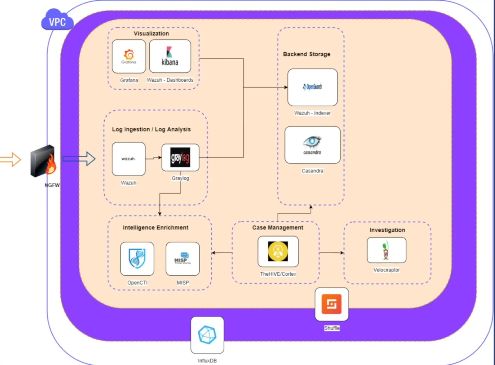

# O que e um SIEM e como montar um?

Na ultima aula vimos o que sao logs, o que eles descrevem, onde sao armazenados e como ler essas informacoes. Porem, apenas aprendemos como le-los manualmente.

Voce consegue imaginar quantos ataques uma organizacao recebe por segundo? Seria inviavel — mesmo com uma equipe enorme — analisar todos esses logs manualmente. Por isso, precisamos de um ecossistema centralizado para coletar, filtrar, correlacionar e visualizar esses eventos. E ai que entra a stack de **SIEM**.

---

## O que e um SIEM?

**SIEM** significa **Security Information and Event Management** (Gerenciamento de Informacoes e Eventos de Seguranca).

E uma plataforma integrada que:
- **Coleta** logs de diversas fontes (endpoints, servidores, firewalls, aplicacoes...)
- **Normaliza** esses dados para um formato padronizado
- **Correlaciona** eventos em tempo real para identificar padroes de ataque
- **Alerta** a equipe de seguranca sobre eventos criticos
- **Armazena** o historico para auditoria e investigacoes forenses
- **Apresenta** dados em dashboards claros para analistas e gestores

Em outras palavras: o SIEM e o **cerebro central** do SOC (Centro de Operacoes de Seguranca). Sem ele, os analistas estariam cegos diante do volume massivo de informacoes.

---

## Componentes Implementados na nossa Stack

Nossa arquitetura foi construida com ferramentas open source, cobrindo todo o ciclo desde a geracao e coleta de eventos no endpoint ate o armazenamento e visualizacao em paineis operacionais.

---

### 1. Endpoint Monitoring & Log Analysis (EDR)

> **O que faz:** Coleta telemetria em profundidade nos servidores e desktops clientes, compara eventos com regras de deteccao e gera alertas estruturados.

| Ferramenta | Funcao na Stack |
|---|---|
| **Wazuh Agent** | Instalado nos endpoints (Linux/Windows). Coleta logs do sistema, integridade de arquivos (FIM), eventos do Sysmon e telemetria de rede via Packetbeat |
| **Wazuh Manager** | Servidor central de analise. Aplica regras de deteccao de ameacas (incluindo regras avancadas SOCFortress), scanner de vulnerabilidades e gera alertas em `alerts.json` |

---

### 2. Log Ingestion & Routing (Ingestao e Roteamento)

> **O que faz:** Transporta, rotula e roteia os logs antes da gravacao definitiva no banco de dados.

| Ferramenta | Funcao na Stack |
|---|---|
| **Fluent-Bit** | Agente de transporte local no servidor do Manager que le o `alerts.json` e o despacha via TCP para o Graylog |
| **Graylog** | Gerencia a ingestao central, adiciona campos estaticos (`log_type: wazuh`), enriquece IPs com geolocalizacao (GeoIP MaxMind) e roteia mensagens atraves de Streams e Stream Rules |

---

### 3. Storage (Armazenamento e Indexacao)

> **O que faz:** Persiste todos os dados de forma particionada, indexada e pesquisavel em alta velocidade.

| Ferramenta | Funcao na Stack |
|---|---|
| **Wazuh Indexer** | Cluster de armazenamento baseado em OpenSearch. Organiza os dados em indices diarios (`wazuh_alerts*`), controla acesso por usuario (RBAC) e politicas de retencao |

**Pontos importantes sobre o storage:**
- **Particionamento temporal:** Os indices sao particionados por data/tamanho, permitindo que investigacoes consultem intervalos especificos sem sobrecarregar o cluster.
- **Isolamento de streams:** O Graylog grava diretamente no conjunto de indices configurado (`Index Set`), evitando duplicidade de dados no disco.
- **Escalabilidade:** Permite operar em no unico ou escalar em clusters multi-no com shards e replicas.

---

### 4. Visualization & Dashboards (Visualizacao)

> **O que faz:** Apresenta os dados de seguranca de forma visual, grafica e correlacionada para os analistas do SOC.

| Ferramenta | Funcao na Stack |
|---|---|
| **Wazuh Dashboard** | Interface nativa do Wazuh para gerenciamento de agentes, regras, modulos de conformidade e scanners |
| **Grafana** | Plataforma avancada de dashboards conectada diretamente ao Wazuh Indexer. Exibe diagramas de fluxo de rede (Sankey), mapas mundiais de consultas DNS (Geomap), series temporais e rankings de processos |

---

## Arquitetura da Stack Implementada



```
[Endpoints: Linux / Windows]
  |-- Wazuh Agent
  |-- Sysmon / Packetbeat
        |
        | (porta 1514 TCP)
        v
[Wazuh Manager]
  |-- Analise de Regras / Alertas
  |-- alerts.json
        |
        v
[Fluent-Bit]
  |-- Leitura do alerts.json
        |
        | (porta 5555 TCP)
        v
[Graylog]
  |-- Ingestao com Static Fields (log_type: wazuh)
  |-- Enriquecimento GeoIP (MaxMind)
  |-- Streams & Stream Rules (isolamento do stream padrao)
        |
        | (HTTPS porta 9200)
        v
[Wazuh Indexer (OpenSearch)]
  |-- Index Set dedicado (wazuh_alerts*)
        |
        +----------------------------+
        |                            |
        v                            v
[Wazuh Dashboard]             [Grafana Server]
(Gestao de Agentes e Regras)  (Sankey, Geomap, Time Series, Bar Chart)
```

---

## Guias de Instalacao Implementados

Abaixo estao os guias detalhados de cada etapa que foi configurada na nossa stack:

| Etapa | Componente | Descricao | Guia |
|---|---|---|---|
| 1 | Wazuh Indexer & Dashboard | Cluster de storage (OpenSearch), dashboard web e certificados TLS | [instalacao/01_wazuh_indexer.md](instalacao/01_wazuh_indexer.md) |
| 2 | Graylog | Ingestao de logs, MongoDB e integracao de certificados Java | [instalacao/02_graylog.md](instalacao/02_graylog.md) |
| 3 | Wazuh Manager | Servidor de analise EDR, Fluent-Bit e regras SOCFortress | [instalacao/03_wazuh_manager.md](instalacao/03_wazuh_manager.md) |
| 4 | Wazuh Agent | Instalacao nos endpoints, integracao Sysmon e Packetbeat | [instalacao/04_wazuh_agent.md](instalacao/04_wazuh_agent.md) |
| 5 | Graylog — Log Routing | Roteamento com Streams, Stream Rules e Index Sets dedicados | [instalacao/05_graylog_routing.md](instalacao/05_graylog_routing.md) |
| 6 | Grafana — Dashboards | Visualizacoes avancadas (Sankey, Geomap, Time Series, Bar Chart) | [instalacao/06_grafana.md](instalacao/06_grafana.md) |

---

## Proximos Passos (Evolucao da Arquitetura)

Com a espinha dorsal de coleta, analise, armazenamento e visualizacao em funcionamento, o ambiente SIEM pode ser expandido futuramente com modulos adicionais:

### 1. Intelligence Enrichment (Enriquecimento com Inteligencia de Ameacas)
- **OpenCTI / MISP:** Integracao com plataformas de Cyber Threat Intelligence (CTI). Permite correlacionar em tempo real IPs, dominios e hashes coletados com feeds globais de ameacas e Indicadores de Comprometimento (IoCs).

### 2. Case Management (Gestao de Casos e Incidentes)
- **TheHIVE / Cortex:** Centralizacao do tratamento de incidentes. Quando um alerta critico e disparado no Wazuh ou Graylog, um caso e criado automaticamente para que os analistas documentem a investigacao e executem acoes no Cortex (consultas no VirusTotal, Shodan, etc.).

### 3. Security Automation & Orchestration (SOAR)
- **Shuffle:** Plataforma de automacao de seguranca via playbooks. Permite automatizar respostas a incidentes sem intervencao humana (ex: isolamento de rede do endpoint comprometido no Wazuh, bloqueio de IP no firewall de borda ou revogacao de credenciais).

### 4. Forensic Investigation (Investigacao Forense em Endpoints)
- **Velociraptor:** Coleta remota e profunda de artefatos forenses (triage VQL, despejo de memoria, investigacao de persistencia e analise de artefatos do Windows/Linux sob demanda).

### 5. Health & Performance Monitoring (Monitoramento da Stack)
- **InfluxDB & Uptime Kuma:** Monitoramento continuo de disponibilidade dos servicos e metricas de performance dos proprios servidores do SIEM (memoria JVM, consumo de disco do indexer e saude dos servicos).
