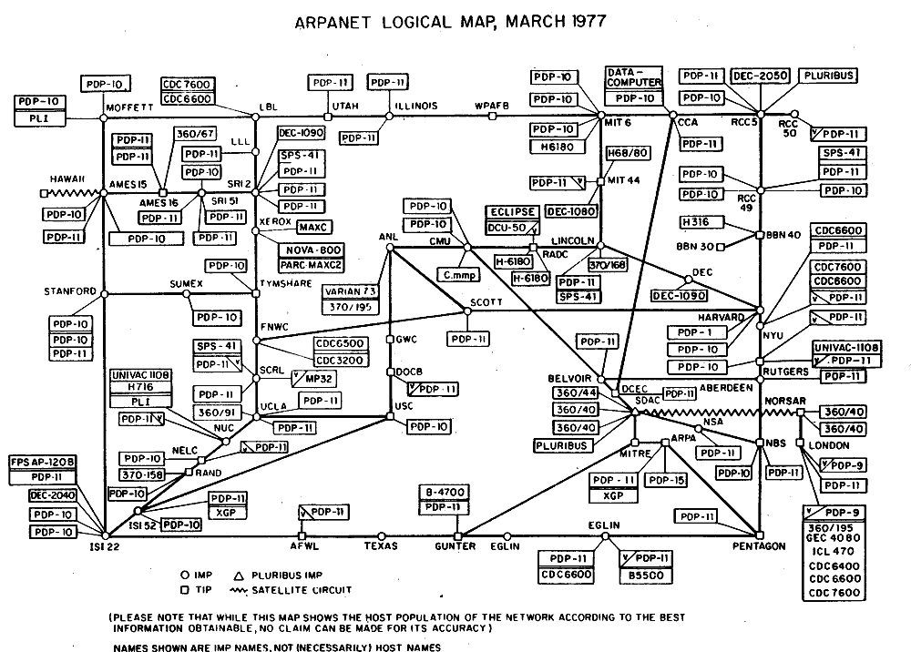

# Protocolos, IP, Portas e TCP/UDP

Você já se perguntou como os dados trafegam do seu computador para o servidor que você está acessando? Nessa aula vamos destrinchar como isso acontece.

A primeira coisa que precisamos entender é como os dados são enviados pela internet. Provavelmente você sabe que os meios de comunicação de um computador são cabos Ethernet, fibra ótica e Wi-Fi. Mas você sabe como os dados são compactados para serem enviados por esses meios físicos?

## Camadas OSI

Para haver uma padronização dos meios de comunicação entre sistemas, foi criado o método em camadas para comunicação. Ele funciona de forma muito lógica e com responsabilidades muito bem definidas!

> **Nota:** O modelo OSI não é utilizado nos sistemas reais; usa-se o modelo de comunicação TCP/IP, que é o modelo que chegou primeiro e já estava sendo colocado em prática. O OSI foi um modelo mais teórico que é usado hoje em dia para explicar a comunicação na internet, e os especialistas o utilizam para se referir a partes da rede.

### 1. Responsabilidades

Como você deve imaginar, o tráfego de uma simples requisição, como um clique para ver a imagem de um gatinho, passa por dezenas, senão centenas de computadores. Se todos os computadores tivessem que ler a mensagem inteira para descobrir o que *eles* têm que fazer, isso levaria a um desperdício computacional gigantesco. Por isso, pensando em minimizar o custo computacional que levaria para ler uma mensagem inteira, foi criado o sistema em camadas, mais especificamente o modelo OSI.

Mas o que é o modelo OSI? Resumindo, ele é um método para encapsular as informações em pequenas camadas para que cada parte da internet fique responsável apenas pelo que lhe interessa. As camadas são:

| Camada TCP/IP | O que representa e toma conta | Exemplos | Camada OSI Equivalente |
| --- | --- | --- | --- |
| 1. Aplicação | Interage diretamente com softwares de aplicativos para fornecer serviços de comunicação e dados ao usuário final, gerenciando protocolos de alto nível. | HTTP/HTTPS, FTP, SMTP, DNS, SSH | Aplicação, Apresentação e Sessão (7, 6 e 5) |
| 2. Transporte | Responsável pela comunicação lógica entre aplicativos em hosts diferentes, garantindo entrega confiável ou rápida, controle de fluxo e correção de erros (*end-to-end*). | TCP, UDP | Transporte (4) |
| 3. Internet (Rede) | Responsável pelo endereçamento lógico e roteamento dos pacotes de dados através de redes distintas, encontrando o melhor caminho até o destino. | IP (IPv4/IPv6), ICMP, ARP | Rede (3) |
| 4. Acesso à Rede | Cuida da transmissão física dos dados pelo meio (cabos, fibras, rádio) e da comunicação local entre dispositivos utilizando endereços físicos (MAC). | Ethernet, Wi-Fi (802.11), PPP, Placas de rede | Enlace de Dados e Física (2 e 1) |

É provável que você ainda não conheça todos os nomes dessa tabela, mas por enquanto apenas entenda que na vida real as informações que você manda e recebe são compactadas e descompactadas a todo momento.

---

### Endereços IP

Acredito que em algum momento você já ouviu falar de algo chamado endereço IP (*Internet Protocol*), mas você sabe o que ele é?

Para descobrir o **IP local** da máquina na rede:

| Sistema | Comando | Onde executar |
| --- | --- | --- |
| Windows | `ipconfig` | Prompt de Comando ou PowerShell |
| macOS | `ifconfig` | Terminal |
| Linux | `ip addr` | Terminal |

Perceba que eu disse IP local e não IP público. Isso acontece por causa de uma das várias decisões tomadas no passado do nosso ramo: em 1981, nos Estados Unidos, quando cientistas da computação estavam tentando descobrir como fazer computadores se comunicarem, foi criado o sistema do IPv4, que padronizava que haveria 2³² endereços de IP para computadores usarem, ou seja, 4.294.967.296 IPs a serem utilizados.

A título de curiosidade, esta é uma imagem do "mapa" da internet em 1977. É incrível pensar que hoje em dia talvez você tenha mais aplicações na sua casa ou no seu bairro do que havia de computadores conectados à internet em 1977. Foi por essa razão que os cientistas da época definiram aquele número; na cabeça deles, não havia a menor chance de alcançarmos aquela quantidade de dispositivos conectados.

Agora vocês devem estar pensando que atualmente esse número deve estar chegando ao seu limite, certo? Mais ou menos. Na verdade, esse número deixou de ser suficiente em 1990, quando a internet aumentou exponencialmente. Cientistas da computação começaram a pensar em alternativas para podermos nos comunicar na internet, e foi nessa época que os endereços de IP foram separados em privados e públicos.

Como isso funciona, você me pergunta? Simples: as operadoras de internet passaram a gerenciar os IPs públicos e usam um sistema chamado CGNAT para fatiar IPs públicos em vários roteadores, que por consequência fornecem os IPs privados para os dispositivos da sua rede local.

Essa é a resposta curta. Na realidade, esses sistemas são extremamente complexos e suas arquiteturas incomodam os administradores de rede desde a sua criação, até porque foram feitos para resolver momentaneamente o problema da escassez de endereços públicos.

Qual é a solução para esse problema então? Essa foi a pergunta feita ainda em 1990, quando as pessoas que cuidavam desses sistemas começaram a perceber que eles iriam acabar. Por menos elegante que pareça, a resposta foi apenas criar mais endereços. Foi por isso que criaram o padrão IPv6, com endereços de 128 bits, ou seja, $2^{128}$. Mas isso resolve o problema? Não há chance de estarmos subestimando o número de endereços de novo e errando assim como nossos antecessores? Bom, pode ser, mas para isso teríamos que alcançar 340.282.366.920.938.463.463.374.607.431.768.211.456 endereços de IP público diferentes (ou seja, 340 undecilhões). Para colocar em perspectiva, cada grão de areia do planeta poderia ter vários endereços de IP público e ainda não esgotaríamos o total, então acho que estamos bem haha.

A única coisa que impede esse sistema de ser aplicado em larga escala hoje em dia é, como sempre, o custo: as empresas que mantêm essa infraestrutura ganham muito dinheiro emprestando e vendendo endereços públicos, além de terem um sistema legado que custaria muito caro para mudar. Então, por enquanto, contente-se em ter que estudar um sistema extremamente complexo e datado.

---

### Portas

Agora que sabemos como uma informação acha o nosso computador (endereço IP), você consegue imaginar como ela sabe qual é o destino certo dentre as centenas de processos rodando na máquina?

Isso é feito pela identificação das portas abertas do processo. Mas o que são portas?

Portas são um identificador numérico de 16 bits (0 a 65535) gerenciado pela camada de transporte (quarta camada do modelo OSI). Simplificando: se o endereço IP for o número do prédio, as portas são os números dos apartamentos dos processos.

#### As Categorias de Portas

As portas são identificadas por números que vão de **0 a 65.535** e são divididas em três grandes grupos:

* **Portas Conhecidas / Well-Known (0 a 1023):** São reservadas para serviços de rede padrão e globais. Os servidores do mundo inteiro escutam nessas portas por padrão.
* *Exemplos:*
* Porta **80**: Tráfego web padrão (HTTP)
* Porta **443**: Tráfego web seguro (HTTPS)
* Porta **22**: Acessos remotos via SSH
* Porta **53**: Consultas de DNS

* **Portas Registradas / Registered (1024 a 49151):** São usadas por aplicativos de usuário ou softwares específicos que não são padrões do sistema operacional, mas que precisam de uma porta fixa para funcionar.
* *Exemplos:*
* Porta **5432**: Usada pelo banco de dados PostgreSQL
* Porta **3306**: Usada pelo MySQL
* Porta **25565**: Usada por servidores de Minecraft

* **Portas Dinâmicas ou Efêmeras (49152 a 65535):** São portas temporárias. Quando o seu computador abre o navegador para acessar um site, o sistema operacional escolhe aleatoriamente uma porta dessa faixa para ser a origem daquela conexão específica. Assim que você fecha a aba, a porta é liberada.

---

### TCP & UDP

Agora que mencionamos as portas por onde os processos se comunicam, é importante falar sobre os protocolos usados para fazer essa comunicação na camada de transporte.

O **TCP** (*Transmission Control Protocol*) e o **UDP** (*User Datagram Protocol*) são os dois principais protocolos da camada de transporte que usamos na internet hoje. Ambos rodam sobre o IP, mas foram criados com filosofias completamente opostas para lidar com o envio de dados.

#### 1. TCP (Transmission Control Protocol)

O TCP é um protocolo **orientado à conexão** e focado em **confiabilidade**. Pense nele como uma ligação telefônica tradicional ou o envio de uma carta com AR (Aviso de Recebimento).

* **Como funciona:** Antes de mandar qualquer dado real, o TCP faz uma negociação de três etapas chamada *Three-Way Handshake* (`SYN`, `SYN-ACK`, `ACK`) para estabelecer a conexão entre as duas pontas.
* **Garantia de entrega:** Se um pacote se perde no meio do caminho, o TCP percebe e exige a retransmissão até que tudo chegue perfeitamente.
* **Ordenação:** Os pacotes podem chegar fora de ordem na rede, mas o TCP reorganiza todos na sequência exata antes de entregar para o aplicativo.
* **Onde é usado:** Em tudo o que não pode ter erro, como carregar páginas web (HTTP/HTTPS), acessar arquivos via SSH ou FTP, enviar e-mails (SMTP) e transferir dados de bancos de dados.

#### 2. UDP (User Datagram Protocol)

O UDP é um protocolo **sem conexão** e focado em **velocidade e leveza**. Pense nele como um alto-falante ou o envio de cartas normais jogadas na caixa postal: você manda e espera que chegue, mas não fica sabendo se o destinatário realmente recebeu.

* **Como funciona:** Ele não faz *handshake*. O aplicativo simplesmente empacota os dados em datagramas e joga na rede em direção ao destino.
* **Sem garantias:** Se um pacote se perde, corrompe ou chega fora de ordem, o UDP não faz nada. Não há pedido de retransmissão.
* **Onde é usado:** Em cenários onde perder um pedacinho de dado é melhor do que atrasar tudo. Exemplos: streaming de vídeo ao vivo, chamadas de voz (VoIP), jogos online competitivos (onde o atraso/lag é pior do que perder um frame) e consultas de DNS.

---

### O que são Requisições HTTP e HTTPS?

Agora que já sabemos como os pacotes encontram o computador certo (IP) e o processo certo dentro dele (Portas) usando o TCP ou o UDP, precisamos entender o que de fato trafega por essa conexão. É aqui que entra o **HTTP** (*HyperText Transfer Protocol*).

Se o TCP/IP é a estrada e o sistema de entrega de cartas, o HTTP é o idioma que o seu navegador e o servidor usam para conversar entre si.

#### Como funciona uma requisição?

A lógica da web funciona inteiramente através do modelo de **Cliente e Servidor**:

* **O Cliente (você/navegador):** Faz um Pedido (*Request*).
* **O Servidor (onde o site está hospedado):** Processa o pedido e devolve uma Resposta (*Response*).

Toda vez que você clica em um link, digita um endereço ou abre uma imagem de gatinho, o seu navegador envia uma requisição HTTP contendo:

* **O Método (Verbo):** O que você quer fazer? (Exemplos: `GET` para buscar algo, `POST` para enviar dados como um formulário de login, `PUT` para atualizar, `DELETE` para apagar).
* **O Caminho (URL/URI):** Qual recurso você quer acessar? (Ex: `/imagens/gatinho.png`).
* **Cabeçalhos (Headers):** Informações extras sobre o seu navegador, idioma, cookies, etc.

O servidor recebe isso, processa e devolve a resposta acompanhada de um **Código de Status** (*Status Code*) que indica se deu certo ou errado:

* **200 OK:** Deu tudo certo! Aqui está o que você pediu.
* **404 Not Found:** O que você procurou não existe.
* **500 Internal Server Error:** Deu ruim lá no servidor.

#### E qual é a diferença para o HTTPS?

O HTTP tradicional tem um problema gravíssimo de segurança: ele envia tudo em texto puro.

Se você digitar sua senha em um site que usa apenas `http://`, qualquer pessoa que estiver interceptando o cabo de rede, o Wi-Fi público ou os roteadores no meio do caminho consegue ler exatamente o que você digitou (isso se chama *sniffing*).

É aí que entra o **HTTPS** (*HyperText Transfer Protocol Secure*):

* Ele é exatamente o mesmo protocolo HTTP, mas com uma camada de segurança criptográfica por cima (através de protocolos como o TLS/SSL).
* Antes de os dados da requisição trafegarem, o cliente e o servidor fazem uma negociação para criar chaves de criptografia exclusivas.
* Assim, mesmo que alguém consiga interceptar os pacotes no meio da rota, tudo o que eles verão serão caracteres aleatórios e ilegíveis.

Hoje em dia, o uso do HTTPS é obrigatório na grande maioria da internet, e os navegadores marcam qualquer site que ainda use HTTP puro como "Não seguro".
